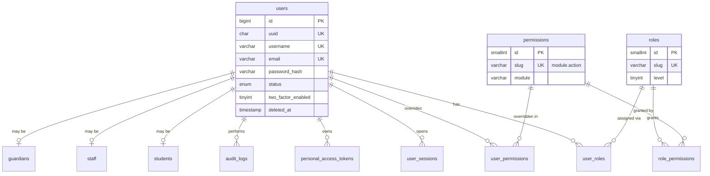
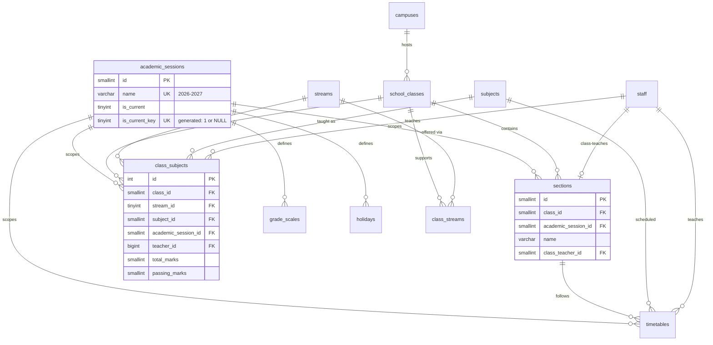
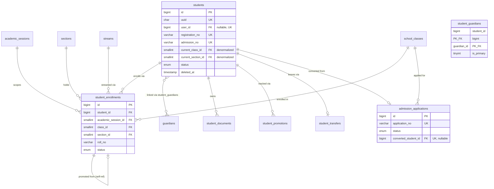
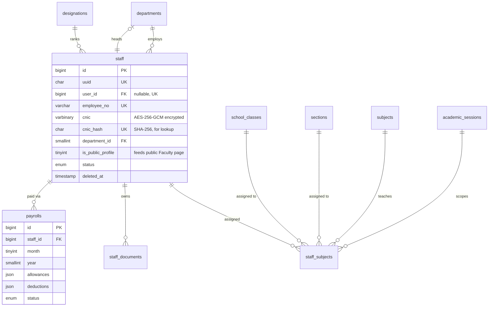
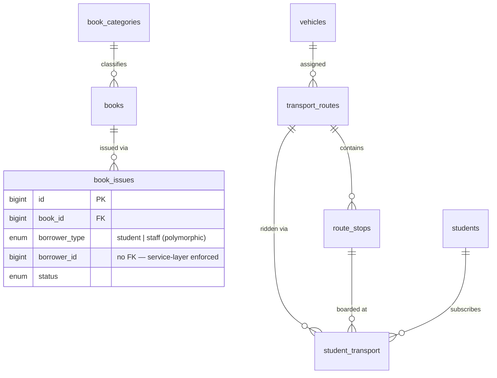
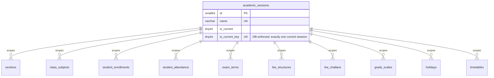

# Entity Relationship Diagram — Final Schema

Reflects the actual implemented schema in `database/migrations/0000`–`0013`.
72 tables across 11 domains. Notation: `||--o{` = one-to-many, `||--o|` = one-to-zero-or-one, `}o--o{` = many-to-many (via pivot).

---

## A. Identity & Access



---

## B. Academic Structure



---

## C. Students, Guardians & Admissions



---

## D. Staff & HR



---

## E. Attendance & Leave

```mermaid
erDiagram
    students ||--o{ student_attendance : "attends as"
    student_enrollments ||--o{ student_attendance : records
    sections ||--o{ student_attendance : scopes
    staff ||--o{ staff_attendance : records
    academic_sessions ||--o{ holidays : defines
    users ||--o{ leave_applications : submits

    student_attendance {
        bigint id PK
        bigint student_id FK
        bigint enrollment_id FK
        date attendance_date
        enum status
        UK student_id_attendance_date "blocks double-marking"
    }
    attendance_monthly_summary {
        bigint id PK
        bigint student_id FK
        smallint year
        tinyint month
        decimal percentage
        note "rebuilt nightly by sp_rebuild_attendance_summary"
    }
    leave_applications {
        bigint id PK
        enum applicant_type "student | staff (polymorphic)"
        bigint applicant_id "no FK — enforced in service layer"
        enum status
    }
```

---

## F. Examination

```mermaid
erDiagram
    academic_sessions ||--o{ exam_terms : contains
    exam_terms ||--o{ exams : schedules
    exam_terms ||--o{ result_summaries : produces
    exam_terms ||--o{ datesheets : publishes
    school_classes ||--o{ exams : "held for"
    subjects ||--o{ exams : "examined in"
    exams ||--o{ marks : receives
    exams ||--o{ exam_attendance : tracks
    students ||--o{ marks : scores
    student_enrollments ||--o{ marks : "scoped by"
    students ||--o{ result_summaries : "summarized in"

    exam_terms {
        smallint id PK
        smallint academic_session_id FK
        varchar name
        decimal weightage
        tinyint is_result_published
    }
    exams {
        int id PK
        smallint exam_term_id FK
        smallint class_id FK
        smallint subject_id FK
        smallint total_marks
        smallint passing_marks
    }
    marks {
        bigint id PK
        int exam_id FK
        bigint student_id FK
        decimal obtained_marks
        decimal total_obtained "generated: obtained+practical"
        varchar grade "auto-set by trigger"
        bigint verified_by
        tinyint is_locked "frozen after verify"
        UK exam_id_student_id
    }
    result_summaries {
        bigint id PK
        bigint student_id FK
        smallint exam_term_id FK
        decimal percentage
        smallint position_in_section
        smallint position_in_class
        tinyint is_published
        UK student_id_exam_term_id
    }
```

---

## G. Finance

```mermaid
erDiagram
    academic_sessions ||--o{ fee_structures : scopes
    school_classes ||--o{ fee_structures : "billed by"
    fee_categories ||--o{ fee_structures : "priced as"
    fee_categories ||--o{ fee_challan_items : "itemized as"
    fee_categories ||--o{ student_fee_discounts : "discounted on"
    students ||--o{ student_fee_discounts : receives
    students ||--o{ fee_challans : "billed via"
    student_enrollments ||--o{ fee_challans : generates
    fee_challans ||--o{ fee_challan_items : "broken into"
    fee_challans ||--o{ fee_payments : "settled by"
    fee_challans ||--o{ fee_fines : "penalized by"
    fee_payments ||--o| fee_payments : "reverses (self-ref)"
    expense_categories ||--o{ expenses : classifies
    staff ||--o{ payrolls : "paid via"

    fee_challans {
        bigint id PK
        varchar challan_no UK
        bigint student_id FK
        decimal payable_amount
        decimal paid_amount
        decimal balance_amount "generated: payable - paid"
        enum status
        UK student_session_period "blocks double-generation"
    }
    fee_payments {
        bigint id PK
        varchar receipt_no UK
        bigint challan_id FK
        decimal amount "negative = reversal"
        bigint reverses_payment_id FK "UK, nullable"
        enum status
        note "APPEND-ONLY — corrections are new rows"
    }
    transactions {
        bigint id PK
        enum type "income | expense"
        enum source_type "fee_payment | expense | payroll"
        bigint source_id
        note "unified ledger, written by triggers"
    }
```

---

## H. CMS / Website

```mermaid
erDiagram
    pages ||--o{ pages : "parent of (self-ref)"
    users ||--o{ pages : authors
    post_categories ||--o{ posts : classifies
    post_categories ||--o{ post_categories : "parent of (self-ref)"
    posts }o--o{ tags : "tagged via post_tags"
    events ||--o| galleries : "documented by"
    galleries ||--o{ gallery_images : contains
    menus ||--o{ menu_items : contains
    menu_items ||--o{ menu_items : "parent of (self-ref)"
    users ||--o{ media : uploads
    school_classes ||--o{ notices : "targeted at"

    pages {
        bigint id PK
        bigint parent_id FK "self-ref"
        varchar slug UK
        tinyint is_system "protects Home/About/Contact"
        enum status
    }
    media {
        bigint id PK
        char uuid UK
        varchar disk "seam for S3 migration"
        varchar entity_type "polymorphic attach point"
        bigint entity_id
    }
    seo_redirects {
        int id PK
        varchar from_path UK
        varchar to_path
        note "auto-written by trg_pages_au_redirect / trg_posts_au_redirect"
    }
```

---

## I. Communication & System

```mermaid
erDiagram
    users ||--o{ notifications : receives
    users ||--o{ messages : "sends/receives"
    messages ||--o{ messages : "thread (self-ref)"
    email_templates ||--o{ email_logs : "rendered as"

    jobs {
        bigint id PK
        varchar queue
        json payload
        note "cron-drained; nothing heavy runs on the request thread"
    }
    audit_logs {
        bigint id PK
        bigint user_id FK
        varchar entity_type
        bigint entity_id
        json old_values
        json new_values
        note "append-only; app DB user has INSERT/SELECT only"
    }
```

---

## J. Optional Modules — Library & Transport



---

## Cross-Domain Spine

The one relationship that ties every domain together:



Every academic and financial table carries `academic_session_id`. This is why year-end promotion (`sp_promote_students`) is a data operation, not a database wipe — a 2026 result card, challan, or attendance record remains queryable forever, scoped to the session it belongs to.

---

## Delete-Rule Legend (as implemented)

| Rule | Where used | Why |
|---|---|---|
| `RESTRICT` | `student_enrollments`, `marks`, `fee_challans`, `fee_payments`, `expenses` FKs to their parents | Academic and financial history is never allowed to vanish via a cascading delete |
| `CASCADE` | `fee_challan_items`→`fee_challans`, `gallery_images`→`galleries`, `menu_items`→`menus`, pivot tables (`role_permissions`, `student_guardians`, `post_tags`, `class_streams`) | True composition — the child has no meaning without the parent |
| `SET NULL` | `students.user_id`, `sections.class_teacher_id`, `pages.parent_id`, `*.created_by`/`updated_by` | Optional references; losing the link shouldn't destroy the row |

No table in this schema is ever hard-deleted by application code. Where a "delete" is expected in the UI, the row carries `deleted_at` (soft delete) or a `status` transition (`cancelled`, `withdrawn`, `archived`) instead.
