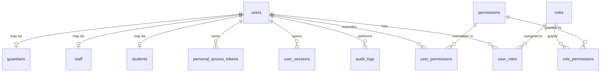
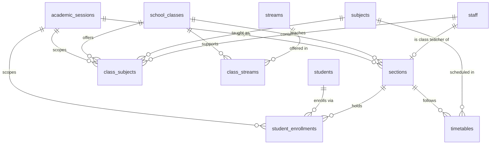
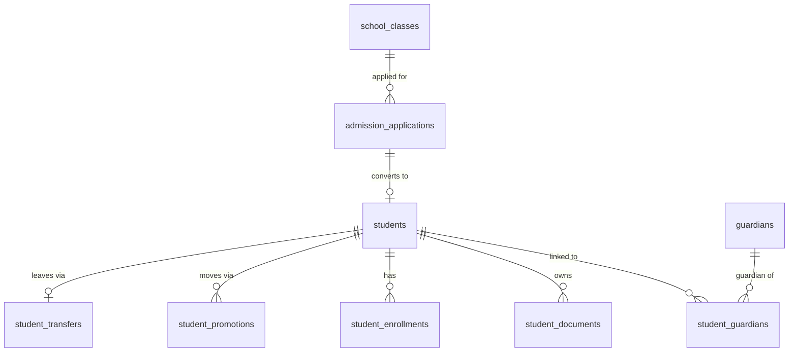
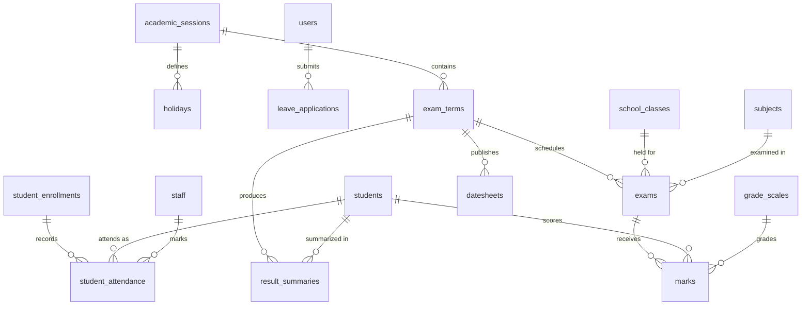
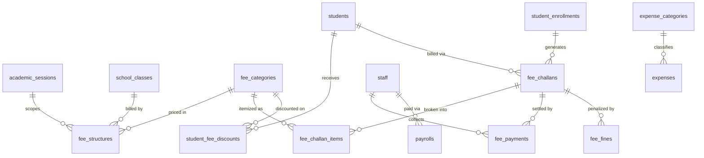
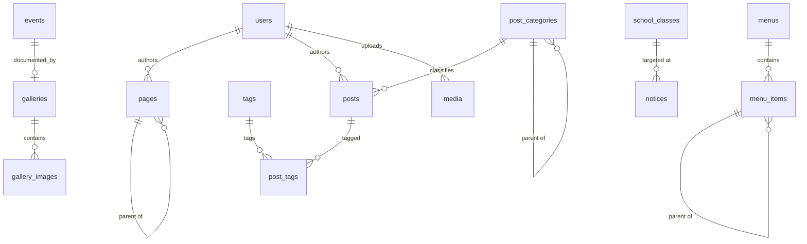

# 02 — Database Design

**Engine:** InnoDB · **Charset:** `utf8mb4` · **Collation:** `utf8mb4_unicode_ci` (Urdu/Arabic-safe)
**Total tables:** ~72 across 10 domains

---

## 1. Universal Column Conventions

Every table follows these rules. No exceptions without a written reason.

| Column | Type | Applies to | Purpose |
|---|---|---|---|
| `id` | `BIGINT UNSIGNED AUTO_INCREMENT PK` | all | Surrogate key |
| `uuid` | `CHAR(36) UNIQUE` | user-facing entities | Safe for public URLs / API — never expose sequential IDs |
| `created_at` | `TIMESTAMP DEFAULT CURRENT_TIMESTAMP` | all | |
| `updated_at` | `TIMESTAMP NULL ON UPDATE CURRENT_TIMESTAMP` | all | |
| `deleted_at` | `TIMESTAMP NULL` | operational data | Soft delete — students/staff/fees are never hard-deleted |
| `created_by` / `updated_by` | `BIGINT UNSIGNED NULL FK→users` | writable data | Accountability |
| `academic_session_id` | `BIGINT UNSIGNED FK` | academic data | Year scoping (see [Architecture §6](01-architecture.md)) |
| `status` | `ENUM` or `TINYINT` | stateful rows | Never a free-text string |
| `sort_order` | `INT DEFAULT 0` | orderable lists | Menus, sliders, subjects |

**Money:** `DECIMAL(12,2)` — **never** `FLOAT`/`DOUBLE`. Rounding errors in fee ledgers are unacceptable.
**Percentages:** `DECIMAL(5,2)`.
**Flexible/sparse data:** `JSON` column (allowances, deductions, audit diffs, settings payloads) — never a comma-separated string.
**Booleans:** `TINYINT(1)` named affirmatively (`is_active`, `is_featured`), never `not_disabled`.

---

## 2. Domain Map

| # | Domain | Tables | Core concern |
|---|---|---|---|
| A | Identity & Access | 11 | Who logs in, what they may do |
| B | Academic Structure | 9 | Sessions, classes, sections, subjects |
| C | Students & Guardians | 8 | The student record and its history |
| D | Staff & HR | 6 | Employees, departments, payroll |
| E | Attendance | 4 | Daily marking, holidays, leave |
| F | Examination | 7 | Exams, marks, grading, results |
| G | Finance | 9 | Fee structures, challans, payments, expenses |
| H | CMS / Website | 16 | Public content, media, SEO, menus |
| I | Communication | 6 | Notifications, messages, mail/SMS logs |
| J | Optional Modules | 8 | Library, transport (hostel later) |
| K | System | 5 | Settings, audit, backups, jobs |

---

## 3. Schema by Domain

### A. Identity & Access

**`users`** — the login identity, deliberately separate from `students`/`staff`
```
id, uuid, username UNIQUE, email UNIQUE, phone,
password_hash, first_name, last_name, avatar,
status ENUM(active,inactive,suspended,pending),
email_verified_at, must_change_password TINYINT,
two_factor_secret, two_factor_enabled,
last_login_at, last_login_ip,
failed_attempts INT, locked_until,
remember_token, created_at, updated_at, deleted_at
```
> **Why split?** A person may be a parent *and* a teacher. A student may exist with no login (young classes). Merging identity into `students` would force a fake account for every child and break the day someone holds two roles.

**`roles`** — `id, slug UNIQUE, name, description, level TINYINT, is_system`
`level` = hierarchy rank; a user can never assign a role at or above their own level.

**`permissions`** — `id, slug UNIQUE, name, module, group_name`
Slug format: `module.action` → `students.create`, `fees.collect`, `marks.verify`.

**`role_permissions`** — `role_id, permission_id` (composite PK)
**`user_roles`** — `user_id, role_id, assigned_by, assigned_at` (composite PK) — multi-role support
**`user_permissions`** — `user_id, permission_id, type ENUM(grant,deny)` — per-user override; `deny` always wins

**`password_resets`** — `email, token_hash, expires_at, used_at, ip`
**`login_attempts`** — `identifier, ip, user_agent, was_successful, attempted_at` (throttling source of truth)
**`user_sessions`** — `id CHAR(64) PK, user_id, ip, user_agent, fingerprint, payload, last_activity` (enables "log out all devices")
**`personal_access_tokens`** — `user_id, name, token_hash UNIQUE, abilities JSON, last_used_at, expires_at`
**`audit_logs`** — `user_id, action, module, entity_type, entity_id, old_values JSON, new_values JSON, ip, user_agent, created_at`

---

### B. Academic Structure

**`academic_sessions`** — `name '2026-2027', start_date, end_date, is_current TINYINT, status ENUM(upcoming,active,closed)`
Partial unique index guarantees exactly one `is_current = 1`.

**`campuses`** — `name, code, address, phone, email, is_active` *(single row today; the seam for multi-campus tomorrow)*

**`school_classes`** — `campus_id, name 'Class 9', short_name, numeric_level TINYINT, wing ENUM(primary,middle,secondary,college), sort_order, is_active`
> Named `school_classes`, not `classes` — avoids collision with the `Class` keyword in ORMs and reads unambiguously in SQL.

**`sections`** — `class_id, name 'A', capacity, room_no, class_teacher_id FK→staff, academic_session_id, is_active`
**`subjects`** — `code UNIQUE, name, name_ur, type ENUM(theory,practical,both), is_elective, is_active`
**`streams`** — `name 'Pre-Medical', code, applies_from_level` *(college side: Pre-Med, Pre-Eng, ICS, Commerce, Arts)*
**`class_streams`** — `class_id, stream_id`

**`class_subjects`** — the pivot that defines a curriculum
```
class_id, stream_id NULL, subject_id, academic_session_id,
teacher_id FK→staff NULL, total_marks, passing_marks,
practical_marks, is_optional, sort_order
UNIQUE(class_id, stream_id, subject_id, academic_session_id)
```

**`timetables`** — `section_id, subject_id, teacher_id, day_of_week TINYINT, period_no, start_time, end_time, room_no, academic_session_id`

---

### C. Students & Guardians

**`students`** — the master record (identity fields, not year-specific)
```
id, uuid, user_id FK→users NULL,
registration_no UNIQUE, admission_no UNIQUE,
first_name, last_name, name_ur,
father_name, father_cnic, father_occupation, father_phone,
mother_name, mother_cnic,
gender ENUM(male,female), date_of_birth, b_form_no,
religion, nationality, blood_group, photo,
address, city, district, province, postal_code,
phone, email,
admission_date, admission_class_id FK,
current_class_id FK, current_section_id FK,   ← denormalized for fast listing
status ENUM(active,graduated,left,suspended,expelled,transferred),
previous_school, previous_class, transport_required,
is_orphan, is_disabled, special_notes,
created_by, updated_by, timestamps, deleted_at
```
> `current_class_id`/`current_section_id` are a deliberate denormalization — they keep the "list all students in 9-A" query off a three-way join. `enrollments` remains the source of truth; a service keeps them in sync inside one transaction.

**`student_enrollments`** — one row per student **per academic session** (the historical spine)
```
student_id, academic_session_id, class_id, section_id, stream_id NULL,
roll_no, enrollment_date, promoted_from_enrollment_id NULL,
result_status ENUM(promoted,detained,pending,left),
status ENUM(active,completed,withdrawn)
UNIQUE(student_id, academic_session_id)
UNIQUE(academic_session_id, section_id, roll_no)
```

**`guardians`** — `user_id NULL, name, relation ENUM(father,mother,uncle,brother,other), cnic UNIQUE, occupation, organization, phone, alt_phone, email, address, is_active`
**`student_guardians`** — `student_id, guardian_id, relation, is_primary, is_emergency_contact` *(many-to-many: siblings share one guardian login)*

**`student_documents`** — `student_id, doc_type ENUM(b_form,father_cnic,photo,previous_result,leaving_certificate,domicile,other), title, file_path, file_size, mime_type, is_verified, verified_by, uploaded_by`
**`student_promotions`** — `from_session_id, to_session_id, from_class_id, to_class_id, student_id, decision, processed_by, processed_at` *(audit of bulk promotion runs)*
**`student_transfers`** — `student_id, type ENUM(leaving,transfer), certificate_no, issue_date, reason, conduct, issued_by, file_path`
**`admission_applications`** — public-facing, pre-enrollment
```
application_no UNIQUE, academic_session_id, class_id, stream_id NULL,
applicant_name, father_name, father_cnic, dob, gender, b_form_no,
phone, email, address, previous_school, previous_percentage,
photo, documents JSON,
status ENUM(submitted,under_review,shortlisted,test_scheduled,test_taken,interview,admitted,rejected,waitlisted),
test_date, test_score, interview_remarks,
converted_student_id FK NULL, reviewed_by, remarks, submitted_ip
```

---

### D. Staff & HR

**`departments`** — `name, code, head_staff_id FK, description, is_active`
**`designations`** — `name, category ENUM(teaching,non_teaching,management,support), rank`
**`staff`**
```
uuid, user_id FK→users, employee_no UNIQUE,
first_name, last_name, father_name, cnic UNIQUE,
gender, date_of_birth, marital_status, blood_group, photo,
department_id, designation_id,
qualification, specialization, experience_years,
joining_date, employment_type ENUM(permanent,contract,visiting,probation),
contract_end_date, basic_salary DECIMAL(12,2),
bank_name, account_no,
phone, emergency_contact, email, address,
is_teaching, is_public_profile, bio, sort_order,
status ENUM(active,on_leave,resigned,terminated,retired),
timestamps, deleted_at
```
> `is_public_profile` + `bio` let the website's Faculty page read from `staff` directly — one source of truth, no duplicate "faculty" table drifting out of sync.

**`staff_subjects`** — `staff_id, subject_id, class_id, section_id, academic_session_id`
**`staff_documents`** — mirrors `student_documents`
**`payrolls`** — `staff_id, month TINYINT, year, basic_salary, allowances JSON, deductions JSON, gross, net_salary, working_days, present_days, leave_days, status ENUM(draft,approved,paid), paid_at, payment_method, generated_by, approved_by` · `UNIQUE(staff_id, month, year)`

---

### E. Attendance

**`student_attendance`**
```
student_id, enrollment_id, academic_session_id,
class_id, section_id, attendance_date DATE,
status ENUM(present,absent,late,leave,half_day),
check_in TIME NULL, remarks, marked_by, marked_at
UNIQUE(student_id, attendance_date)
INDEX(section_id, attendance_date)
INDEX(academic_session_id, student_id, status)
```
> `UNIQUE(student_id, attendance_date)` is the single most important constraint in this domain — it makes double-marking structurally impossible, no matter what the UI does.

**`staff_attendance`** — same shape, `staff_id` + `check_in`/`check_out`
**`holidays`** — `title, date_from, date_to, type ENUM(public,religious,vacation,emergency), applies_to ENUM(all,students,staff), academic_session_id, description`
**`leave_applications`** — `applicant_type ENUM(student,staff), applicant_id, leave_type, from_date, to_date, days, reason, attachment, status ENUM(pending,approved,rejected,cancelled), reviewed_by, reviewed_at, review_remarks`

---

### F. Examination

**`exam_terms`** — `name 'First Term', academic_session_id, type ENUM(monthly,mid,final,test,pre_board), start_date, end_date, weightage DECIMAL(5,2), is_result_published, published_at, status`
**`exams`** — `exam_term_id, class_id, stream_id NULL, subject_id, exam_date, start_time, end_time, total_marks, passing_marks, practical_total, practical_passing, room_no` · `UNIQUE(exam_term_id, class_id, subject_id)`
**`marks`**
```
exam_id, student_id, enrollment_id,
obtained_marks DECIMAL(6,2) NULL, practical_obtained DECIMAL(6,2) NULL,
is_absent TINYINT, grade VARCHAR(5), grade_point DECIMAL(3,2),
remarks, entered_by, entered_at, verified_by, verified_at,
is_locked TINYINT
UNIQUE(exam_id, student_id)
```
> `entered_by` / `verified_by` / `is_locked` implement four-eyes control: a teacher enters, an exam controller verifies, and the row locks. Post-verification edits require a permission and always write to `audit_logs`.

**`grade_scales`** — `name, academic_session_id, min_percentage, max_percentage, grade 'A+', grade_point, remarks 'Excellent', is_fail`
**`result_summaries`** — computed per student per term
```
student_id, enrollment_id, exam_term_id, academic_session_id,
class_id, section_id,
total_marks, obtained_marks, percentage DECIMAL(5,2),
grade, grade_point, position_in_section, position_in_class,
subjects_total, subjects_failed,
result_status ENUM(pass,fail,promoted,detained,absent),
remarks, is_published, published_at, generated_at
UNIQUE(student_id, exam_term_id)
```
**`datesheets`** — `exam_term_id, class_id, title, file_path, published_at`
**`exam_attendance`** — `exam_id, student_id, is_present, remarks`

---

### G. Finance

**`fee_categories`** — `name 'Tuition Fee', code, type ENUM(recurring,one_time), is_refundable, is_active, sort_order`
**`fee_structures`** — what a class owes, per session
```
academic_session_id, class_id, stream_id NULL, fee_category_id,
amount DECIMAL(12,2),
frequency ENUM(monthly,quarterly,bi_annual,annual,one_time),
due_day TINYINT, applies_to ENUM(all,new,existing), is_active
UNIQUE(academic_session_id, class_id, stream_id, fee_category_id)
```
**`student_fee_discounts`** — `student_id, fee_category_id NULL, academic_session_id, type ENUM(percentage,fixed), value, reason ENUM(sibling,merit,staff_child,hardship,orphan,other), valid_from, valid_to, approved_by, remarks`
**`fee_challans`** — the invoice
```
challan_no UNIQUE, student_id, enrollment_id, academic_session_id,
class_id, section_id,
billing_month TINYINT NULL, billing_year,
issue_date, due_date,
gross_amount, discount_amount, fine_amount, payable_amount,
paid_amount, balance_amount,
status ENUM(unpaid,partial,paid,overdue,cancelled),
generated_by, cancelled_by, cancel_reason, notes
INDEX(student_id, status), INDEX(academic_session_id, billing_month, billing_year)
```
**`fee_challan_items`** — `challan_id, fee_category_id, description, amount, discount, net_amount` *(a challan is never a single opaque number — it always itemizes)*
**`fee_payments`**
```
receipt_no UNIQUE, challan_id, student_id, amount DECIMAL(12,2),
payment_date, method ENUM(cash,bank_deposit,cheque,online,card),
bank_name, transaction_ref, cheque_no, cheque_date,
received_by, verified_by, status ENUM(pending,cleared,bounced,refunded),
remarks, attachment
```
> Payments are **append-only**. A correction is a new reversing row, never an `UPDATE` of history. This is what makes the ledger auditable.

**`fee_fines`** — `challan_id, rule ENUM(fixed,per_day,percentage), amount, applied_on, waived_by, waive_reason`
**`expense_categories`** — `name, code, is_active`
**`expenses`** — `voucher_no UNIQUE, expense_category_id, title, description, amount, expense_date, paid_to, payment_method, reference_no, attachment, academic_session_id, status ENUM(pending,approved,paid,rejected), requested_by, approved_by, approved_at`
**`transactions`** — unified ledger view: `type ENUM(income,expense), source_type, source_id, amount, transaction_date, account, description` *(feeds the finance dashboard without UNION-ing five tables at runtime)*

---

### H. CMS / Website

**`pages`** — `parent_id, title, slug UNIQUE, content LONGTEXT, excerpt, featured_image, template, meta_title, meta_description, meta_keywords, og_image, canonical_url, sort_order, is_system, show_in_menu, status ENUM(draft,published,scheduled), published_at, author_id, views`
> `is_system = 1` on Home/About/Contact prevents an editor from deleting a page the router depends on.

**`post_categories`** — `name, slug, parent_id, description, sort_order`
**`posts`** *(news & articles)* — `category_id, title, slug UNIQUE, excerpt, content LONGTEXT, featured_image, gallery JSON, meta_*, status, is_featured, is_pinned, views, published_at, author_id`
**`tags`** / **`post_tags`** — many-to-many
**`events`** — `title, slug UNIQUE, description, content, banner, start_datetime, end_datetime, venue, organizer, category, registration_required, registration_url, capacity, is_featured, status, meta_*`
**`notices`** — `title, slug, content, attachment, audience ENUM(all,students,parents,staff,specific_class), class_id NULL, priority ENUM(low,normal,high,urgent), publish_from, publish_to, is_pinned, status, views, author_id`
**`galleries`** — `title, slug UNIQUE, description, cover_image, event_id NULL, gallery_date, category, status, sort_order`
**`gallery_images`** — `gallery_id, image_path, thumbnail_path, caption, alt_text, sort_order`
**`sliders`** — `title, subtitle, description, image, mobile_image, button_text, button_url, text_position, overlay_opacity, sort_order, is_active, starts_at, ends_at`
**`downloads`** — `title, description, category, file_path, file_name, file_size, mime_type, audience, download_count, is_active, uploaded_by`
**`menus`** — `name, location ENUM(header,footer,quick_links,sidebar,mobile), is_active`
**`menu_items`** — `menu_id, parent_id, title, type ENUM(page,post,category,custom,module), reference_id NULL, url, icon, target ENUM(_self,_blank), sort_order, is_active`
**`media`** — the shared media library
```
uuid, filename, original_name, path, thumbnail_path,
mime_type, extension, size_bytes, width, height,
folder, alt_text, caption, disk,
uploaded_by, entity_type NULL, entity_id NULL
```
**`settings`** — `group_name, key_name UNIQUE, value TEXT, type ENUM(text,textarea,number,boolean,image,file,json,select), options JSON, label, description, is_public, sort_order`
Groups: `general`, `contact`, `social`, `seo`, `academic`, `fee`, `mail`, `sms`, `appearance`.
**`faqs`** — `question, answer, category, sort_order, is_active`
**`testimonials`** — `name, designation, photo, content, rating, type ENUM(student,parent,alumni), is_featured, status`
**`contact_messages`** — `name, email, phone, subject, message, ip_address, user_agent, status ENUM(new,read,replied,spam,archived), replied_by, replied_at, reply_message`
**`seo_redirects`** — `from_path UNIQUE, to_path, status_code ENUM(301,302), hits, is_active`
**`page_views`** — `url, entity_type, entity_id, ip_hash, referrer, user_agent, viewed_at` *(lightweight in-house analytics; partitioned/pruned monthly)*

---

### I. Communication

**`notifications`** — `user_id, type, title, body, icon, data JSON, action_url, read_at, priority` · `INDEX(user_id, read_at)`
**`messages`** — `sender_id, receiver_id, parent_id, subject, body, attachment, read_at, is_starred, deleted_by_sender, deleted_by_receiver`
**`email_templates`** — `slug UNIQUE, name, subject, body LONGTEXT, available_variables JSON, is_active`
**`email_logs`** — `to_email, cc, subject, template_slug, body, status ENUM(queued,sent,failed), error_message, attempts, sent_at`
**`sms_templates`** / **`sms_logs`** — same shape *(gateway integration is Phase-later; the tables exist now so the code path is already in place)*

---

### J. Optional Modules

**Library:** `book_categories`, `books` (isbn, title, author, publisher, edition, category_id, total_copies, available_copies, shelf_no, price), `book_issues` (book_id, borrower_type, borrower_id, issue_date, due_date, return_date, fine, status, issued_by)
**Transport:** `vehicles` (reg_no, type, capacity, driver_id, model, insurance_expiry), `transport_routes` (name, start_point, end_point, fare, vehicle_id), `route_stops` (route_id, stop_name, pickup_time, drop_time, fare, sort_order), `student_transport` (student_id, route_id, stop_id, academic_session_id, monthly_fare, status)

---

### K. System

**`jobs`** — `queue, payload JSON, attempts, available_at, reserved_at` *(cron-drained; keeps bulk email/SMS off the request cycle)*
**`failed_jobs`** — `payload JSON, exception LONGTEXT, failed_at`
**`backups`** — `filename, path, size_bytes, type ENUM(database,files,full), status, created_by, created_at`
**`cron_logs`** — `job_name, status, output, duration_ms, ran_at`
**`cache`** — `key_name UNIQUE, value LONGTEXT, expires_at` *(DB cache fallback)*

---

## 4. Entity Relationship Diagrams

### Core: Identity & Access



### Academic Structure & Enrollment



### Students, Guardians & Admission



### Attendance & Examination



### Finance



### CMS / Website



---

## 5. Key Relationship Rules

| Relationship | Cardinality | Delete rule | Rationale |
|---|---|---|---|
| `users` → `students` | 1 : 0..1 | `SET NULL` | Deleting a login must never destroy the student record |
| `students` → `student_enrollments` | 1 : N | `RESTRICT` | Enrollment history is permanent |
| `student_enrollments` → `student_attendance` | 1 : N | `CASCADE` | Attendance is meaningless without its enrollment |
| `students` ↔ `guardians` | M : N | pivot `CASCADE` | Siblings legitimately share a guardian |
| `exams` → `marks` | 1 : N | `RESTRICT` | Marks are academic records — protected |
| `fee_challans` → `fee_challan_items` | 1 : N | `CASCADE` | Items have no life outside their challan |
| `fee_challans` → `fee_payments` | 1 : N | `RESTRICT` | Financial history is never destroyed |
| `galleries` → `gallery_images` | 1 : N | `CASCADE` | |
| `menus` → `menu_items` | 1 : N | `CASCADE` | |
| `posts` ↔ `tags` | M : N | pivot `CASCADE` | |

**Default posture:** `ON DELETE RESTRICT` for anything academic or financial; `CASCADE` only for true child/composition rows; `SET NULL` for optional references. Where a business "delete" is expected, the application soft-deletes instead.

---

## 6. Indexing Strategy

Indexes are designed around the queries that actually run, not sprinkled on every FK.

| Table | Index | Serves |
|---|---|---|
| `students` | `(status, current_class_id, current_section_id)` | Admin student list — the most-hit query in the system |
| `students` | `FULLTEXT(first_name, last_name, father_name)` | Global search box |
| `students` | `UNIQUE(registration_no)`, `UNIQUE(admission_no)` | Identity integrity |
| `student_enrollments` | `UNIQUE(student_id, academic_session_id)` | Blocks double enrollment |
| `student_enrollments` | `UNIQUE(academic_session_id, section_id, roll_no)` | Blocks duplicate roll numbers |
| `student_attendance` | `UNIQUE(student_id, attendance_date)` | Blocks double marking |
| `student_attendance` | `(section_id, attendance_date)` | Daily marking sheet |
| `student_attendance` | `(academic_session_id, student_id, status)` | Monthly percentage reports |
| `marks` | `UNIQUE(exam_id, student_id)` | One mark per student per exam |
| `result_summaries` | `(exam_term_id, class_id, percentage DESC)` | Position/merit calculation |
| `fee_challans` | `(status, due_date)` | Overdue-challan cron |
| `fee_challans` | `(student_id, academic_session_id)` | Parent's fee ledger |
| `fee_payments` | `(payment_date, status)` | Daily collection report |
| `posts`/`pages`/`events` | `(status, published_at DESC)`, `UNIQUE(slug)` | Public listings + routing |
| `audit_logs` | `(entity_type, entity_id)`, `(user_id, created_at)` | Record history & user trail |
| `notifications` | `(user_id, read_at)` | Unread badge count |

**Anti-patterns explicitly avoided:** no index on low-cardinality columns alone (`gender`, `is_active`); no redundant single-column index where a composite already leads with it; no `LIKE '%term%'` on large tables — that's what the FULLTEXT index is for.

---

## 7. Data Integrity Beyond Foreign Keys

Some rules can't be expressed as an FK. These are enforced in the **Service layer, inside a transaction**:

| Rule | Where enforced |
|---|---|
| Exactly one `academic_sessions.is_current = 1` | `AcademicSessionService` + generated unique column |
| `marks.obtained_marks ≤ exams.total_marks` | `MarkService` + `Validator` rule `marks_within` |
| `fee_payments` sum ≤ `fee_challans.payable_amount` | `PaymentService` (`SELECT … FOR UPDATE`) |
| `fee_challans.balance = payable − paid` | Recomputed on every payment inside the same transaction |
| Section enrollment ≤ `sections.capacity` | `EnrollmentService` |
| A student can't be promoted twice in one session | `UNIQUE(student_id, academic_session_id)` on enrollments |
| Result publishable only when every subject has marks | `ResultService::canPublish()` |
| Teacher may only enter marks for own `class_subjects` | `MarkPolicy` + query scope |

> These are written as **service-level invariants with database constraints behind them wherever possible** — belt and braces. The DB constraint is what saves you when someone runs a script that bypasses the app.

---

## 8. Migrations & Seeding

**Migrations** — numbered, forward-only SQL files in `database/migrations/`:
```
0001_create_users_and_roles.sql
0002_create_academic_structure.sql
0003_create_students.sql
…
```
A `migrations` table tracks what's been applied; `scripts/migrate.php` runs pending files in order inside a transaction.

**Seeders** — idempotent, in `database/seeders/`:
1. `RoleSeeder` + `PermissionSeeder` (the RBAC matrix from [Modules & Roles](03-modules-roles.md))
2. `SettingSeeder` (site name, contact, social, SEO defaults)
3. `AcademicSeeder` (current session, classes, sections, subjects, grade scale)
4. `FeeSeeder` (categories)
5. `SuperAdminSeeder` (one account, forced password change on first login)
6. `DemoSeeder` — **development only**, never runs when `APP_ENV=production`

---

## 9. Backup & Retention

| What | Frequency | Retention |
|---|---|---|
| Full DB dump (`mysqldump`, gzip) | Nightly 02:00 via cron | 30 daily + 12 monthly |
| Uploads (`storage/app/uploads`) | Weekly incremental | 8 weeks |
| Pre-migration snapshot | Before every migration run | Until next successful deploy |
| `page_views` pruning | Monthly | 12 months |
| `email_logs` / `sms_logs` pruning | Monthly | 6 months |
| `audit_logs` | **Never pruned** | Permanent (archived yearly) |

Financial and academic tables are never truncated — a school must be able to reproduce a 2019 result card in 2029.
